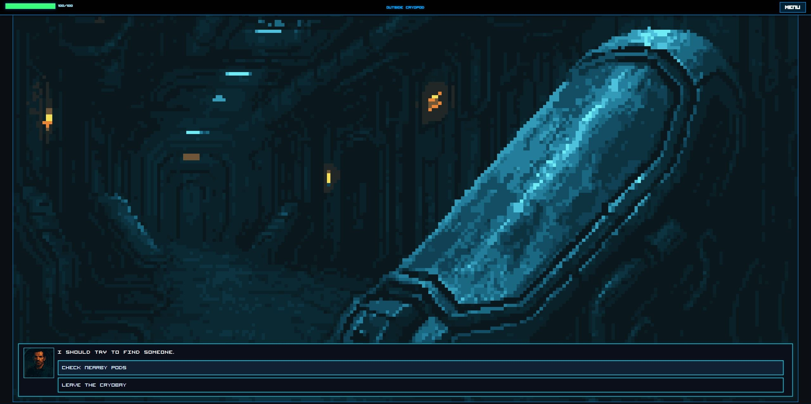
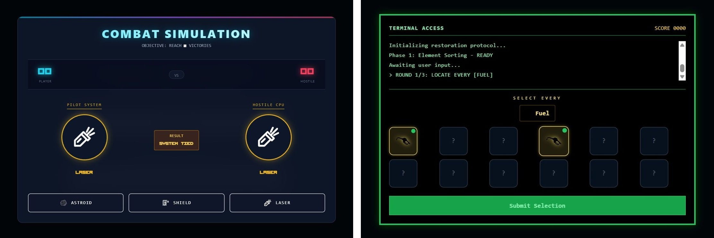
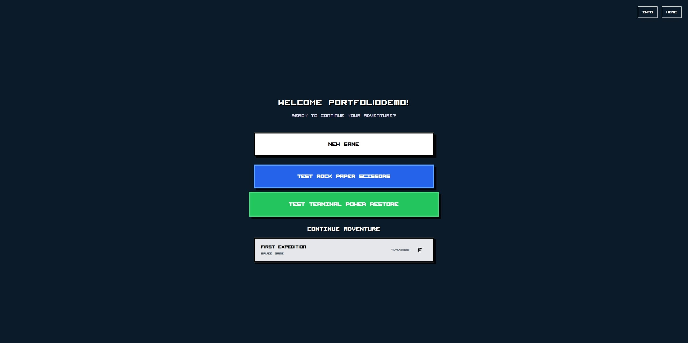

# After the Jump

**After the Jump** is a sci-fi adventure where your choices shape the story. Explore the ship, play minigames, and pick up where you left off.



## Minigames



- **Combat Simulation (left).** Face off against the ship's computer using Asteroid, Shield, and Laser.
- **Power Restoration (right).** Find the right components to restore power through the ship's terminal.

## Saved adventures

Keep up to three named saves and resume your story from the game menu. Progress saves automatically.



## Play locally

Install [Node.js 22](https://nodejs.org/) and the [.NET 8 SDK](https://dotnet.microsoft.com/download/dotnet/8.0), then run:

```sh
git clone https://github.com/Hernyg/DotNET-project.git
cd DotNET-project
npm ci
npm start
```

Open [localhost:3000](http://localhost:3000), register a local account, sign in, and select **New Game**. Use at least eight characters with upper- and lowercase letters, a number, and a symbol for your password.

The first launch creates and seeds both SQLite databases. The web app uses port 3000 and the API uses port 5169. Press Ctrl+C to stop both servers. If PowerShell blocks npm, use `npm.cmd ci` and `npm.cmd start`.

## Tech stack

| Area | Technology | What it does |
| --- | --- | --- |
| Frontend | React, Tailwind CSS, Framer Motion | Renders dialogue, story choices, and minigames. |
| Backend | ASP.NET Core 8, C# | Serves the REST API for accounts, story progression, and saves. |
| Data | Entity Framework Core, SQLite | Stores story content, accounts, and saved games. |
| Authentication | ASP.NET Core Identity, JWT | Handles registration, sign-in, and authenticated requests. |

Built as an OsloMet team project in Autumn 2025. [Original team repository](https://github.com/Adamsol1/DotNET-project)
